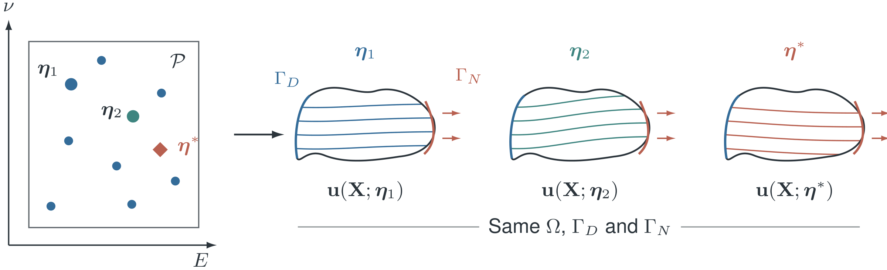
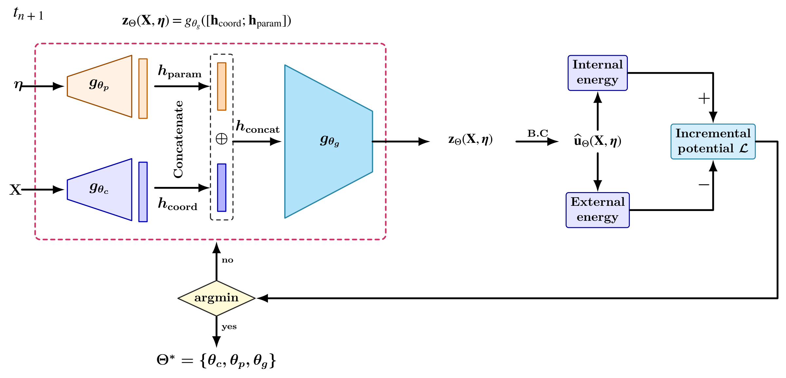

# CPDEM

Constitutive Parameterized Deep Energy Method for solid mechanics. Representative PyTorch examples train shared material-conditioned displacement networks by minimizing potential energy. Coordinates and material samples are generated at runtime.

## Highlights

- CPDEM learns material parameter-to-solution maps by minimizing expected energy.
- Energy gaps bound parameter-averaged errors in stable linear-elastic families.
- Pretrained models predict unseen in-range material responses without retraining.
- Benchmarks span elasticity, hyperelasticity, elastoplasticity, and viscoelasticity.





## Usage

Requires Python 3.10 or newer. CPU and CUDA are supported.

```bash
python -m pip install -r requirements.txt
python bar1d_linear.py
python beam2d_linear.py
python beam2d_neohookean.py
```

Common options: `--device cpu`, `--steps 1500`, `--lbfgs-steps 100`, `--seed 2025`, and `--output outputs/model.pt`. Checkpoints contain the network state, sampled materials, and run configuration.

`CPDEM.py` provides the shared network, quadrature, training, and checkpoint utilities. Each case script defines its mechanical energy and training materials.

## Testing

```bash
python test_CPDEM.py
python test_CPDEM.py --checkpoint outputs/bar1d_linear.pt --material 1.75
python test_CPDEM.py --checkpoint outputs/beam2d_linear.pt --material 250 0.28
python test_CPDEM.py --checkpoint outputs/beam2d_neohookean.pt --material 950 0.28
```

The checks cover displacement boundaries, energy gradients, analytical bar energy, undeformed beam states, and checkpoint restoration. Checkpoint evaluation reports displacement ranges and the bar's analytical relative error; `--output outputs/predictions.csv` exports predictions.

## Source

Extracted from the CPDEM server project: `run_bar1d_generalization.py`, `run_p2inn_vs_cpdem_plane_strain.py`, and `run_neohookean_ablation.py`. The package retains the network and energy definitions with simplified training entry points for the representative examples.

## Citation

```bibtex
@article{liang2026constitutive,
  title={Constitutive parameterized deep energy method for solid mechanics problems with random material parameters},
  author={Liang, Zhangyong and Zhu, Jihong and Gao, Huanhuan},
  journal={arXiv preprint arXiv:2603.26030},
  year={2026}
}
```

## Contact

[zyliang1994@tju.edu.cn](mailto:zyliang1994@tju.edu.cn)
